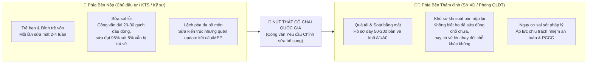

# BUSINESS REQUIREMENTS DOCUMENT (BRD)
## DỰ ÁN: NỀN TẢNG DX-OS OPEN-CORE & ỨNG DỤNG MÔI TRƯỜNG DỮ LIỆU CHUNG (CDE) THẨM ĐỊNH TỰ ĐỘNG HỒ SƠ XÂY DỰNG BẰNG AI AGENT

---

| Thông tin tài liệu | Chi tiết |
| :--- | :--- |
| **Tên dự án** | DX-OS Open-Core: CDE & AI-Powered Construction Permit Appraisal Platform |
| **Hạng mục dự thi** | Olympic Tin học Sinh viên Việt Nam 2026 — Khối Phần mềm Nguồn Mở (PMNM - Khối H) |
| **Cơ quan chủ trì đề bài** | Hội Tin học Việt Nam (VAIP) & CLB Phần mềm Tự do Nguồn mở Việt Nam (VFOSSA) |
| **Phiên bản tài liệu** | 1.0.0 |
| **Trạng thái** | Hoàn thành |
| **Ngày lập** | 19/10/2026 |

---

## 1. TỔNG QUAN DỰ ÁN & BỐI CẢNH

### 1.1. Bối cảnh Cuộc thi OLP Tin học Sinh viên 2026 (Khối PMNM)
Đề thi Khối Phần mềm Nguồn mở (PMNM) năm 2026 đặt ra bài toán trọng tâm: **"Xây dựng Hệ điều hành Chuyển đổi số bằng Công nghệ Lõi nguồn mở (DX-OS Open-Core)"**. 
* **Yêu cầu cốt lõi:** Phải xây dựng một kiến trúc **tháp 3 tầng** chuẩn hóa. Trong đó, **Tầng 1** bắt buộc là một nền tảng dịch vụ lõi chạy ngầm (Headless PaaS, không UI) đảm nhiệm 4 trụ cột: Định danh (SSO/IAM), Cổng API Gateway, Quản trị Dữ liệu (Cấu trúc & Phi cấu trúc) và Động cơ Luồng công việc (Workflow Engine). 
* **Tầng 2 & Tầng 3:** Yêu cầu có ít nhất một ứng dụng thực chiến nằm trong không gian năng lực số **H-P-D-I** (Human - Process - Data - Intelligence) và nền tảng kinh doanh số.
* **Định hướng chuyên ngành:** Đề bài tại Trang 3 đã chỉ rõ mô hình định hướng: *"Quản trị Thời gian và Dự án: Môi trường dữ liệu chung cho xây dựng (CDE) tích hợp mô hình 3D BIM"*.

### 1.2. Bối cảnh Nghiệp vụ Ngành Xây dựng tại Việt Nam
* **Cơ sở pháp lý:** Luật Xây dựng số 50/2014/QH13, Luật sửa đổi số 62/2020/QH14 (đặc biệt là Điều 102 về Quy trình cấp phép và sửa đổi, bổ sung hồ sơ), Nghị định 15/2021/NĐ-CP, Nghị định 35/2023/NĐ-CP, và các Quy chuẩn Kỹ thuật Quốc gia (QCVN 06:2022/BXD về PCCC, QCVN 01:2021/BXD về Quy hoạch xây dựng).
* **Vấn đề cốt lõi:** Quy trình thẩm định hồ sơ thiết kế và cấp Giấy phép Xây dựng (GPXD) hiện là nút thắt cổ chai lớn nhất trong chuỗi đầu tư xây dựng. Tỷ lệ hồ sơ phải trả về để yêu cầu sửa đổi, bổ sung ở lần nộp đầu tiên chiếm trên **80%**. Việc sửa đổi thủ công kéo dài gây lãng phí hàng nghìn tỷ đồng chi phí vốn và cơ hội phát triển đô thị.

---

## 2. PHÂN TÍCH THỰC TRẠNG & ĐIỂM ĐAU (PAIN POINTS)

### 2.1. Điểm đau của Bên Nộp (Doanh nghiệp, Đơn vị Tư vấn Thiết kế, Kỹ sư)
1. **Áp lực rủi ro bị từ chối cấp phép:** Theo Điều 102 Luật Xây dựng, cơ quan thẩm định chỉ thông báo sửa đổi bổ sung có thời hạn. Nếu sau 2 lần bổ sung mà vẫn không đạt yêu cầu, hồ sơ sẽ bị đình chỉ/từ chối cấp phép, dự án phải làm lại từ đầu.
2. **Khó khăn trong việc định vị và tổng hợp lỗi:** Công văn góp ý của cơ quan thẩm định mang tính văn bản hành chính (ví dụ: *"Yêu cầu điều chỉnh chiều rộng bản thang trục 2-3 đảm bảo PCCC"*). Kỹ sư phải tự lục lọi trong hàng chục file CAD/PDF để tìm vị trí, dễ xảy ra tình trạng "sửa chỗ này, sót chỗ kia".
3. **Mất kiểm soát phiên bản (Version Sprawl):** Khi có nhiều bộ môn (Kiến trúc, Kết cấu, MEP) cùng sửa đổi, các bên thường gửi file qua Zalo/Email rời rạc, dẫn đến bộ hồ sơ nộp lại không đồng nhất.

### 2.2. Điểm đau của Bên Thẩm định (Sở Xây dựng, Phòng Quản lý Đô thị, Cơ quan Thẩm tra)
1. **Khối lượng công việc quá tải:** Một chuyên viên thụ lý phải đọc hàng trăm bộ hồ sơ mỗi tháng. Mỗi bộ gồm thuyết minh dày cộp kèm 50 - 200 bản vẽ kỹ thuật khổ lớn.
2. **Mỏi mắt khi đối soát "Hồ sơ nộp lại" (Version Fatigue):** Khi nhận bản vẽ nộp lại (V2), cán bộ phải căng mắt so từng nét vẽ của V1 và V2 xem đơn vị thiết kế đã sửa đúng yêu cầu chưa, đồng thời phải phòng ngừa việc đơn vị thiết kế "vẽ lén" cơi nới diện tích hoặc thay đổi công năng ngoài thẩm duyệt.
3. **Thiếu công cụ số hóa hỗ trợ rà soát quy chuẩn:** Cán bộ phải tự tra cứu thủ công hàng nghìn trang tiêu chuẩn, quy chuẩn (QCVN/TCVN).

---

## 3. MỤC TIÊU DỰ ÁN & GIẢI PHÁP ĐỀ XUẤT

### 3.1. Tầm nhìn & Mục tiêu Chiến lược
Xây dựng một nền tảng **Môi trường Dữ liệu Chung (CDE - Common Data Environment)** dựa trên kiến trúc **DX-OS Open-Core**, tích hợp **Tác tử Trí tuệ Nhân tạo Đa phương thức (Multimodal AI Agent)** nhằm tự động hóa quy trình:
1. Tiếp nhận hồ sơ bản vẽ và công văn yêu cầu sửa đổi.
2. Tự động bóc tách nội dung công văn, ánh xạ chính xác vị trí lỗi lên từng tọa độ bản vẽ CAD/PDF/BIM.
3. Tự động sinh ra **Kế hoạch sửa chữa (To-do Action Plan)** cho Kỹ sư thiết kế.
4. Tự động **so sánh sai lệch (Diffing V1 vs V2)** hỗ trợ Cán bộ thẩm định ra quyết định nhanh chóng, minh bạch.

### 3.2. Nguyên tắc Bắt buộc: "Human-in-the-Loop" (Con người Giữ quyền Quyết định)
> [!IMPORTANT]
> **Nguyên tắc Pháp lý:** Trong lĩnh vực xây dựng, hồ sơ thiết kế gắn liền với an toàn tính mạng con người và trách nhiệm pháp lý hình sự. AI tuyệt đối **không đóng vai trò quyết định thay con người**, mà đóng vai trò là **Trợ lý Thông minh (Co-Pilot)**:
> * AI phát hiện, khoanh vùng, gợi ý quy chuẩn và lập bảng kế hoạch.
> * Kỹ sư chủ trì là người kiểm tra, chỉnh sửa bản vẽ và ký tên chịu trách nhiệm.
> * Cán bộ thẩm định là người xem xét báo cáo đối soát của AI và ký duyệt cấp phép.

---

## 4. CHÂN DUNG NGƯỜI DÙNG & CÁC BÊN LIÊN QUAN (STAKEHOLDERS)

| Vai trò | Đối tượng | Mục tiêu chính khi dùng hệ thống |
| :--- | :--- | :--- |
| **Kỹ sư / Đơn vị Tư vấn Thiết kế** *(Applicant/Designer)* | Các KTS, Kỹ sư xây dựng lập hồ sơ xin phép | • Tải bản vẽ và công văn góp ý lên hệ thống. • Nhìn thấy ngay các lỗi được highlight trực quan trên bản vẽ. • Nhận Action Plan chi tiết từng việc cần làm để sửa 1 lần là đạt ngay. |
| **Cán bộ / Chuyên viên Thẩm định** *(Reviewer/Appraiser)* | Cán bộ Sở Xây dựng, Phòng QLĐT quận/huyện | • Xem danh sách hồ sơ được phân công. • Xem báo cáo so sánh tự động bản vẽ V1 vs V2 (vị trí nào đã sửa, vị trí nào chưa đạt). • Ra quyết định phê duyệt hoặc ban hành công văn yêu cầu sửa đổi mới. |
| **Quản trị viên Hệ thống** *(DevOps/System Admin)* | Đơn vị vận hành hạ tầng số cơ quan | • Quản lý hạ tầng PaaS lõi (Tầng 1). • Cấu hình các luồng quy trình nghiệp vụ (BPMN Workflow). • Giám sát tài nguyên, an toàn thông tin và nhật ký kiểm toán. |

---

## 5. YÊU CẦU NGHIỆP VỤ CHI TIẾT (BUSINESS REQUIREMENTS)

### BR-01: Quản trị Hồ sơ Thiết kế Chuẩn CDE (Common Data Environment)
* Hệ thống phải hoạt động như một kho lưu trữ dữ liệu chung an toàn, lưu trữ toàn bộ các phiên bản bản vẽ (PDF vector, DWG/DXF 2D, mô hình IFC 3D) và tài liệu pháp lý.
* Đảm bảo tính toàn vẹn, phân quyền bảo mật nhiều cấp (Kỹ sư chỉ xem hồ sơ dự án của mình; Cán bộ chỉ xem hồ sơ được phân công thụ lý).

### BR-02: Bóc tách Tự động Văn bản Yêu cầu Chỉnh sửa (Công văn / Checklist)
* Hệ thống tiếp nhận văn bản yêu cầu chỉnh sửa (file PDF văn bản hành chính, ảnh chụp công văn có dấu đỏ hoặc checklist đánh giá).
* Tự động nhận diện cấu trúc, bóc tách ra danh sách các vấn đề (Issues) riêng biệt:
  * Mã vấn đề (Issue ID).
  * Mô tả nội dung vi phạm (Ví dụ: "Cửa thoát hiểm mở ngược chiều").
  * Điều khoản quy chuẩn liên quan (Ví dụ: "Vi phạm QCVN 06:2022/BXD Mục 3.2.1").
  * Bộ môn liên quan (Kiến trúc, PCCC, Kết cấu, Quy hoạch).

### BR-03: Định vị Trực quan Lỗi lên Bản vẽ (Issue-to-Drawing Grounding)
* Tự động ánh xạ nội dung lỗi trong công văn đến đúng file bản vẽ, trang bản vẽ và vùng không gian cụ thể.
* Hiển thị bounding box (khung chữ nhật màu đỏ/vàng) trực tiếp trên bản vẽ trực quan trên giao diện Web, cho phép zoom-in/zoom-out và click vào để xem chi tiết lý do vi phạm.

### BR-04: Lập Kế hoạch Sửa đổi (Action Plan Generator)
* Hệ thống tự động biên soạn danh sách công việc cần làm (To-Do Checklist) cho Kỹ sư theo mức độ ưu tiên:
  1. Lỗi nghiêm trọng (Vi phạm chỉ giới, an toàn PCCC, chiều cao tầng).
  2. Lỗi tài liệu/thuyết minh (Sai lệch số liệu bảng thống kê diện tích).
  3. Lỗi hoàn thiện/ghi chú kỹ thuật.
* Cung cấp gợi ý giải pháp kỹ thuật cụ thể để khắc phục lỗi đạt chuẩn.

### BR-05: Tự động Đối soát Phiên bản Nộp lại (Automated Version Diffing)
* Khi Kỹ sư nộp lại hồ sơ phiên bản mới (V2) kèm Bản giải trình, hệ thống tự động chạy quy trình so sánh trực quan và đối chiếu ngữ nghĩa:
  * Đánh giá xem các điểm trong công văn lần 1 đã được sửa đạt chưa (Trạng thái: *Đã sửa đạt / Chưa sửa / Sửa chưa đúng*).
  * Phát hiện và cảnh báo các vị trí bị thay đổi ngoài phạm vi yêu cầu (tránh tình trạng "vẽ lén").
  * Xuất Báo cáo Thẩm định Sơ bộ (Pre-check Audit Report) cho Cán bộ thẩm định tham khảo trước khi ra quyết định.

### BR-06: Quản lý Luồng Phê duyệt Nghiệp vụ (BPMN 2.0 Workflow)
* Toàn bộ trạng thái hồ sơ phải được điều khiển bởi một Động cơ Quy trình (Workflow Engine) chuẩn BPMN 2.0.
* Tự động kích hoạt các mốc thời gian (SLA timers) theo đúng quy định pháp luật (ví dụ: Thông báo sửa đổi trong vòng 07 ngày làm việc).

---

## 6. QUY TẮC NGHIỆP VỤ (BUSINESS RULES)

* **BRule-01 (Giới hạn sửa đổi):** Hệ thống cảnh báo đỏ nếu một hồ sơ bị yêu cầu sửa đổi đến lần thứ 2, nhằm cảnh báo nguy cơ bị từ chối cấp phép theo quy định Điều 102 Luật Xây dựng.
* **BRule-02 (Bảo toàn bằng chứng pháp lý):** Không ai (kể cả Admin) được phép xóa hoặc chỉnh sửa nội dung của các phiên bản bản vẽ và công văn đã nộp. Dữ liệu phải được đánh dấu thời gian (timestamp) và lưu trữ bất biến.
* **BRule-03 (Phê duyệt có kiểm chứng):** Để bấm nút phê duyệt cấp phép, cán bộ thẩm định bắt buộc phải xác nhận đã kiểm tra toàn bộ danh sách các cảnh báo vi phạm do AI phát hiện.
* **BRule-04 (100% Mã nguồn Mở):** Toàn bộ các cấu phần phần mềm phải tuân thủ giấy phép tự do nguồn mở (GPL, Apache 2.0, MIT, MPL), tuyệt đối không phụ thuộc vào các dịch vụ đám mây thương mại đóng (như Autodesk Forge, OpenAI API trả phí).

---

## 7. TIÊU CHÍ ĐÁNH GIÁ THÀNH CÔNG (SUCCESS METRICS / KPIS)

| Chỉ số (KPI) | Hiện trạng (Thủ công) | Kỳ vọng khi ứng dụng Hệ thống |
| :--- | :--- | :--- |
| **Thời gian chuẩn bị hồ sơ sửa đổi của Kỹ sư** | 7 – 14 ngày làm việc | Giảm xuống còn **1 – 2 ngày** nhờ có Action Plan và tọa độ lỗi chỉ điểm sẵn. |
| **Tỷ lệ sót lỗi khi nộp lại hồ sơ lần 2** | 30% – 45% hồ sơ vẫn còn sót lỗi | Giảm xuống **< 5%**. |
| **Thời gian rà soát hồ sơ nộp lại của Cán bộ** | 3 – 5 ngày / bộ hồ sơ | Giảm xuống còn **15 – 30 phút** nhờ tính năng tự động so sánh Diff V1 vs V2. |
| **Thời gian triển khai hạ tầng PaaS lõi (Tầng 1)** | Phức tạp, cài đặt thủ công nhiều tuần | Khởi động hoàn chỉnh toàn bộ hệ thống bằng 1 lệnh `docker compose up -d` trong **dưới 3 phút**. |
