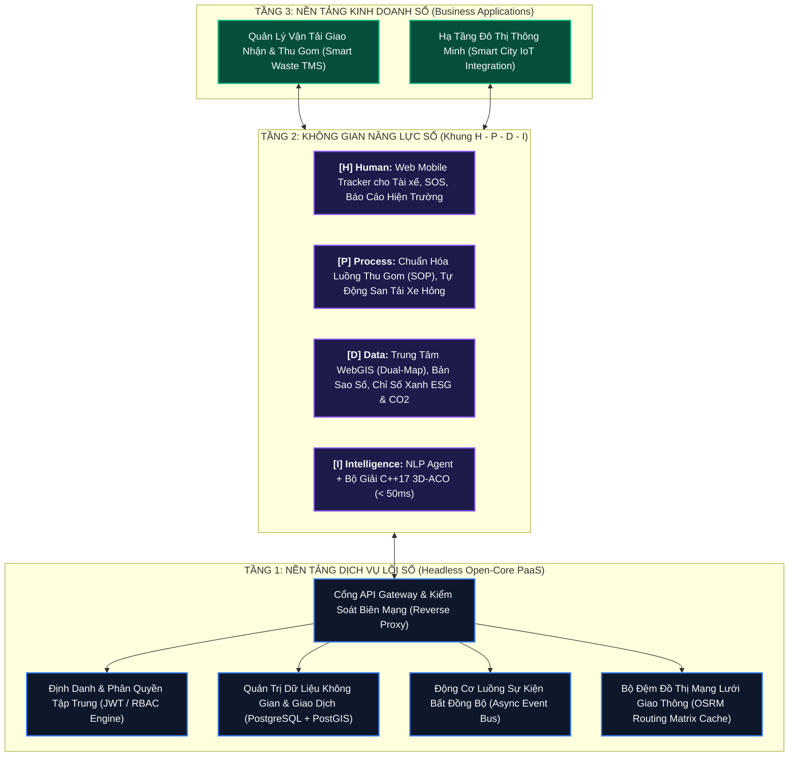

# DX-OS Open-Core
### Nền Tảng Chuyển Đổi Số Kiến Trúc Lõi Mở & Hệ Thống Điều Phối Vận Tải Đô Thị Thông Minh

[](LICENSE)
[](docs/ARCHITECTURE.md)
[](docs/HPDI_SPECIFICATION.md)
[](apps/solver_core/)
[](docker-compose.yml)
[](#4-quy-chuẩn-bản-đồ--dữ-liệu-không-gian)

---

## 1. Tổng Quan Hệ Thống

DX-OS Open-Core là nền tảng quản trị và chuyển đổi số được thiết kế theo kiến trúc Lõi mở (Open-Core) với mô hình tháp 3 tầng. Hệ thống phân định ranh giới rõ ràng giữa dịch vụ nền tảng chạy ngầm (Headless PaaS), không gian năng lực số hóa quản trị (Khung H-P-D-I) và ứng dụng nghiệp vụ chuyên ngành.

Để chứng minh tính khả thi kỹ thuật, hệ thống tích hợp ứng dụng thực tế trong lĩnh vực **Quản lý Vận tải & Điều phối Đội xe Thu gom Rác Đô thị (Smart City Waste TMS)**, giải quyết bài toán định tuyến phương tiện đa điểm có giới hạn tải trọng (CVRP) và tự động xử lý sự cố giao thông hiện trường theo thời gian thực.


---

## 2. Kiến Trúc Tháp 3 Tầng



### Các Tầng Chức Năng:
1. **Tầng 1 - Nền tảng Dịch vụ Lõi số (Headless PaaS):** Vận hành ngầm, không giao diện người dùng cuối. Cung cấp các dịch vụ hạ tầng dùng chung: Quản trị định danh (SSO/JWT), Cổng API Gateway, Cơ sở dữ liệu không gian (PostGIS), Động cơ luồng công việc (Event Bus), và Bộ đệm đồ thị OSRM.
2. **Tầng 2 - Không gian Năng lực số (Khung H-P-D-I):** Cung cấp các công cụ tương tác số hóa quản trị tổ chức theo 4 không gian: Human, Process, Data, Intelligence.
3. **Tầng 3 - Ứng dụng Nghiệp vụ:** Module chuyên ngành Quản trị Vận tải & Điều phối Thu gom Rác Đô thị (TMS).

---

## 3. Đặc Tả Không Gian Năng Lực Số H - P - D - I

| Không Gian Số | Chức Năng Kỹ Thuật | Thành Phần Hiện Thực Trong Hệ Thống |
|---|---|---|
| **[H] Human** <br/>*(Con người số)* | Môi trường kết nối nhân sự hiện trường, truyền phát trạng thái và phản ánh thông tin hai chiều. | **Web Mobile Tracker:** Chạy trên trình duyệt di động, tự động đồng bộ tọa độ GPS vệ tinh, vận tốc, mức pin; gửi phản ánh hiện trường bằng giọng nói/văn bản và phát tín hiệu SOS khẩn cấp. |
| **[P] Process** <br/>*(Quy trình số)* | Chuẩn hóa quy trình vận hành tiêu chuẩn (SOP), thiết lập luồng xử lý và tự động hóa phản ứng sự cố. | **SOP Thu gom & Tự động Phản ứng Ngoại lệ:** Gặp rào chắn/đường cấm $\rightarrow$ tự động tìm đường vòng thay thế; phương tiện hỏng hóc giữa tuyến $\rightarrow$ tự động chia tải các điểm gom chưa thực hiện sang xe kế cận. |
| **[D] Data** <br/>*(Dữ liệu số)* | Quản trị dựa trên dữ liệu thực chứng; trực quan hóa không gian địa lý; tính toán chỉ số hiệu năng. | **Trung tâm Điều hành WebGIS (IOC) - Chế độ Bản Đồ Kép:** Trực quan hóa bản sao số (Digital Twin) đội xe và thùng rác; hiển thị song song hai thuật toán đối chiếu; tự động tính toán phát thải $\text{CO}_2$ cắt giảm và quãng đường tiết kiệm. |
| **[I] Intelligence** <br/>*(Trí tuệ số)* | Ứng dụng trí tuệ nhân tạo và giải thuật bầy đàn giải quyết bài toán tối ưu hóa phức hợp. | **Tác tử NLP + Bộ giải C++17 3D-ACO:** Đọc hiểu báo cáo hiện trường để tự động kích hoạt chế độ "thu gom đi bộ vào ngõ hẻm"; thuật toán bầy đàn song song 3 chiều tính toán lộ trình tối ưu trong `< 50ms`. |

---

## 4. Quy Chuẩn Bản Đồ & Dữ Liệu Không Gian

* **Chủ quyền lãnh thổ:** Hệ thống sử dụng nguồn dữ liệu bản đồ từ **OpenStreetMap Tile Server** và lớp vệ tinh **ArcGIS World Imagery**. Toàn bộ hệ thống không sử dụng bất kỳ nguồn bản đồ nào có đường 9 đoạn.
* **Dữ liệu kiểm thử:** Tọa độ thực nghiệm được số hóa trên địa bàn Quận 1 và Quận 3, TP. Hồ Chí Minh với tên đường và địa danh chính thống.
* **Hệ quy chiếu:** Chuẩn không gian tọa độ WGS84 (SRID 4326) lưu trữ trực tiếp trên PostgreSQL + PostGIS.

---

## 5. Cài Đặt & Triển Khai

### Yêu Cầu Tiên Quyết
* Docker Engine $\ge 20.10$
* Docker Compose $\ge 2.0$

### Triển Khai Bằng Docker Compose
```bash
# 1. Khởi động toàn bộ cụm dịch vụ
docker compose up -d --build

# 2. Kiểm tra trạng thái các container
docker compose ps
```

### Danh Mục Cổng Dịch Vụ:
* 🗺️ **Trung tâm Điều hành WebGIS IOC:** [http://localhost:8502](http://localhost:8502)
* 📊 **Bảng Phân Tích & Nghiên Cứu Thuật Toán (Streamlit):** [http://localhost:8501](http://localhost:8501)
* 🔌 **Cổng API Backend & Solver Core (Swagger UI):** [http://localhost:8000/docs](http://localhost:8000/docs)
* 🗄️ **Cơ Sở Dữ Liệu PostgreSQL + PostGIS:** Cổng `5432` (`user: dx_admin`, `db: dx_os_db`)

Để dừng hệ thống:
```bash
docker compose down
```

---

## 6. Kịch Bản Vận Hành & Kiểm Thử Hệ Thống

Chi tiết từng bước kiểm thử xem tại [docs/SCENARIOS_AND_OPERATIONS.md](docs/SCENARIOS_AND_OPERATIONS.md).

1. **Kiểm thử Tối ưu hóa Tuyến Tuyến Đa Xe:** Truy cập cổng 8502, chọn kịch bản `Q.1 Trung Tâm & Phố Đi Bộ` và nhấn `Tối Ưu Hóa Lộ Trình`. Hệ thống sẽ phân bổ các điểm gom cho từng xe dựa trên thuật toán 3D-ACO và hiển thị lộ trình bám theo đồ thị OSRM.
2. **Kiểm thử Xử lý Rào chắn Đường:** Nhấn nút mô phỏng rào chắn thi công trên đường. Hệ thống loại bỏ đoạn đường khỏi đồ thị và tự động tính toán lại đường vòng trong thời gian dưới 50 mili-giây.
3. **Kiểm thử San Tải Phương Tiện Hỏng:** Mô phỏng sự cố xe số 1 bị hỏng động cơ. Các điểm gom còn lại của xe này sẽ được tự động phân bổ sang các xe kế cận còn khả dụng dung tích.
4. **Kiểm thử Nhận diện Báo cáo Hiện trường:** Nhập phản ánh tài xế *"Hẻm 42 Nguyễn Huệ xe không vào được"*. Tác tử NLP nhận diện sự cố và tự động chuyển sang chế độ thu gom đi bộ tại đầu hẻm.

---

## 7. Cấu Trúc Mã Nguồn

```
dx-os-open-core/
├── core-platform/                         # TẦNG 1: NỀN TẢNG DỊCH VỤ LÕI SỐ (Headless PaaS)
│   ├── gateway/                           # Cấu hình API Gateway & Reverse Proxy (Nginx)
│   ├── auth/                              # Quản trị định danh & phân quyền (JWT / RBAC)
│   ├── database/                          # Cấu trúc CSDL Không gian (PostgreSQL + PostGIS init.sql)
│   └── workflow/                          # Động cơ sự kiện bất đồng bộ (Async Event Bus)
│
├── apps/                                  # TẦNG 2 & 3: ỨNG DỤNG THỰC CHỨNG (Smart City Waste TMS)
│   ├── map_dispatcher/                    # [D] Data: Trung tâm Điều hành WebGIS IOC (Port 8502)
│   │   ├── index.html                     # Giao diện bản đồ tương tác thời gian thực
│   │   ├── server.py                      # Máy chủ điều phối & API xử lý sự cố
│   │   └── waste_solver.py                # Động cơ giải thuật định tuyến & tái định tuyến < 50ms
│   ├── solver_core/                       # [I] Intelligence: Lõi giải thuật C++17 3D-Parallel ACO
│   │   ├── CMakeLists.txt                 # Cấu hình biên dịch CMake
│   │   ├── core/                          # Các lớp thực thể VRP (Node, Depot, Customer, Locker)
│   │   └── solvers/                       # Cài đặt thuật toán PACO, ACO, SA, ALNS
│   ├── analytics/                         # Bảng phân tích tham số thuật toán (Port 8501)
│   └── backend_service/                   # Dịch vụ API backend phụ trợ (Port 8000)
│
├── docs/                                  # TÀI LIỆU KỸ THUẬT HỆ THỐNG
│   ├── ARCHITECTURE.md                    # Đặc tả chi tiết Khung Kiến trúc Tháp 3 Tầng
│   ├── HPDI_SPECIFICATION.md              # Phân rã kỹ thuật 4 không gian số H - P - D - I
│   ├── SCENARIOS_AND_OPERATIONS.md        # Hướng dẫn vận hành & các kịch bản kiểm thử
│   ├── API_REFERENCE.md                   # Đặc tả toàn bộ RESTful API & WebSocket
│   └── DEPLOYMENT_CHECKLIST.md            # Danh sách kiểm tra đóng gói & triển khai
│
├── assets/                                # Ảnh kiến trúc, demo GIF và tài nguyên giao diện
├── docker-compose.yml                     # Cấu hình triển khai hệ sinh thái đồng nhất
├── Dockerfile                             # Đóng gói môi trường container
├── start.sh                               # Script khởi động tự động
├── .env.example                           # Mẫu cấu hình biến môi trường
├── .gitignore                             # Bộ lọc loại bỏ tệp tin rác
└── LICENSE                                # Giấy phép mã nguồn mở Apache 2.0
```

---

## 8. Giấy Phép Bản Quyền (License)

Dự án được phân phối dưới giấy phép mã nguồn mở **Apache License 2.0**. Xem chi tiết tại tệp [`LICENSE`](LICENSE).