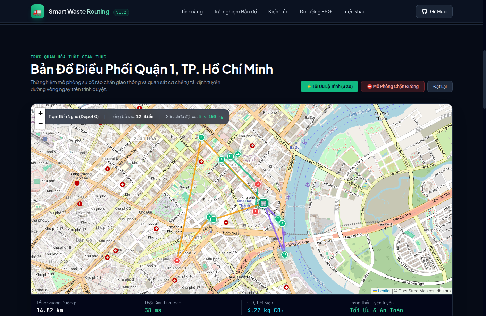
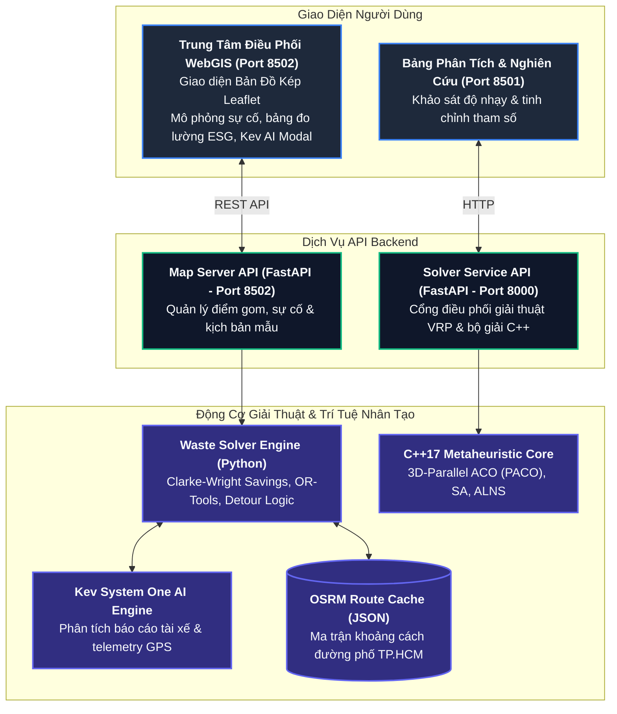

# Smart Waste Routing & Dynamic Incident Dispatcher
### Hệ Thống Tối Ưu Lộ Trình & Điều Phối Tuyến Thu Gom Rác Thông Minh Tức Thời

[](LICENSE)
[](https://www.python.org/)
[](https://fastapi.tiangolo.com)
[](src/)
[](docker-compose.yml)
[](#4-tuân-thủ-quy-chuẩn-bản-đồ--chủ-quyền-lãnh-thổ)

---

## 1. Giới Thiệu

Dự án cung cấp giải pháp toàn diện cho bài toán quản lý, tối ưu hóa lộ trình và điều phối đội xe thu gom rác thải đô thị thời gian thực. Hệ thống giải quyết các vấn đề đặc thù trong giao thông đô thị Việt Nam:
* **Mạng lưới ngõ hẻm phức tạp:** Tự động nhận diện bô rác trong hẻm sâu và tính toán vị trí đỗ xe tại đầu hẻm để nhân viên đi bộ tiếp cận (*walk-in alley collection*).
* **Tác tử điều phối hiện trường Kev AI:** Tự động tiếp nhận và phân tích phản ánh giọng nói/văn bản của tài xế cùng dữ liệu GPS để phân loại sự cố và kích hoạt phương án ứng phó tức thì.
* **Sự cố giao thông phát sinh liên tục:** Khi xảy ra ngập úng hoặc rào chắn thi công đột xuất, hệ thống tự động tìm đường vòng thay thế (detour) trong thời gian `< 50ms`.
* **San tải khi phương tiện gặp sự cố kỹ thuật:** Tự động điều phối các thùng rác chưa gom của xe bị hỏng sang các xe lân cận còn dung tích chứa khả dụng.
* **Tối ưu hóa chỉ số môi trường (ESG):** Đo lường trực tiếp quãng đường tiết kiệm và lượng phát thải $\text{CO}_2$ cắt giảm so với phương pháp truyền thống.



---

## 2. Kiến Trúc Hệ Thống



---

## 3. Các Tính Năng Kỹ Thuật Cốt Lõi

| Nhóm Tính Năng | Cơ Chế Hiện Thực | Giá Trị Thực Tiễn |
|---|---|---|
| **Tối Ưu Hóa Tuyến Đa Xe (CVRP)** | Thuật toán Clarke-Wright Savings kết hợp hệ số thưởng cho các thùng rác bốc mùi (`has_smell=true`) | Tối ưu hóa tải trọng phương tiện, ưu tiên giải phóng sớm các điểm ô nhiễm nghiêm trọng |
| **Tái Định Tuyến Sự Cố (< 50ms)** | Động cơ phát hiện đoạn đường rào chắn và tái cấu trúc lộ trình trên đồ thị OSRM | Phương tiện tự động chuyển hướng đường vòng tức thời, không bị nghẽn tuyến |
| **San Tải Phương Tiện Hỏng** | Tự động phân bổ lại danh sách bô rác của xe gặp sự cố sang các xe lân cận | Loại bỏ tình trạng ứ đọng rác khi xe gặp sự cố kỹ thuật giữa ca làm việc |
| **Thu Gom Ngõ Hẻm Nhỏ (Walk-in)** | Tự động xác định điểm đỗ xe đầu ngõ và vạch tuyến đi bộ tiếp cận thùng rác | Thích ứng với hạ tầng ngõ ngách đặc thù tại các đô thị lớn |
| **Bản Đồ Kép Trực Quan (Dual-Map)** | Hiển thị song song hai khung nhìn Leaflet để đối chiếu giải pháp đề xuất với thuật toán Baseline | Đánh giá trực quan sự khác biệt về quỹ đạo và độ dài tuyến đường |
| **Bảng Đo Lường Chỉ Số Xanh (ESG)** | Tính toán quãng đường cắt giảm, khối lượng phát thải $\text{CO}_2$ ($\Delta D \times 0.285 \text{ kg/km}$) | Cung cấp số liệu định lượng phục vụ công tác giám sát môi trường |
| **Điều Phối Tác Tử Kev AI** | Tích hợp **Kev System One AI Engine** qua endpoint `/api/waste/driver-report` tiếp nhận phản ánh tài xế & telemetry GPS | Tự động nhận diện ngữ cảnh thực địa (hẻm hẹp, hỏng xe, cấm đường) và kích hoạt quy trình tái định tuyến tức thì |

---

## 4. Tuân Thủ Quy Chuẩn Bản Đồ & Chủ Quyền Lãnh Thổ

> [!IMPORTANT]
> Hệ thống tuân thủ nghiêm ngặt quy định pháp luật Việt Nam về bản đồ và dữ liệu địa lý:
> - **100% Tuyệt đối không sử dụng bất kỳ nguồn bản đồ nào có đường 9 đoạn (đường lưỡi bò)**.
> - Lớp bản đồ giao thông: Sử dụng **OpenStreetMap Tile Server** chuẩn quốc tế.
> - Lớp bản đồ vệ tinh: Sử dụng **ArcGIS World Imagery** chất lượng cao.
> - Dữ liệu tọa độ kiểm thử được số hóa trực tiếp tại địa bàn **Quận 1 và Quận 3, TP. Hồ Chí Minh** với đầy đủ tên đường phố tiếng Việt chính thống.

---

## 5. Hướng Dẫn Cài Đặt & Khởi Chạy

### Cách 1: Triển Khai Bằng Docker Compose (Khuyến nghị)
Yêu cầu hệ thống đã cài đặt Docker và Docker Compose:

```bash
# 1. Khởi động toàn bộ hệ thống
docker compose up -d --build

# 2. Kiểm tra trạng thái hoạt động của container
docker compose ps
```

Sau khi khởi chạy thành công, truy cập các cổng dịch vụ:
* 🗺️ **Trung tâm Điều phối WebGIS (Giao diện chính):** [http://localhost:8502](http://localhost:8502)
* 📊 **Bảng Phân Tích & Tinh Chỉnh Tham Số (Streamlit):** [http://localhost:8501](http://localhost:8501)
* 🔌 **Cổng API Backend & Solver Core (Swagger UI):** [http://localhost:8000/docs](http://localhost:8000/docs)

Để dừng hệ thống:
```bash
docker compose down
```

---

### Cách 2: Chạy Trực Tiếp Bằng Bash Script (Local Development)
Yêu cầu máy chủ Linux có sẵn Python $\ge 3.10$, `cmake`, `build-essential`:

```bash
chmod +x start.sh
./start.sh
```

---

## 6. Kịch Bản Kiểm Thử Nhanh

1. Mở trình duyệt truy cập `http://localhost:8502`.
2. Tại bảng điều khiển bên trái, chọn kịch bản mẫu: **`Q.1 Trung Tâm & Phố Đi Bộ`**, nhấn nút **`Tối Ưu Hóa Lộ Trình (Solve VRP)`**.
3. Quan sát các tuyến đường được phân màu riêng biệt theo từng xe, bám sát các khúc cua đường phố TP.HCM và bảng chỉ số ESG cập nhật số kg $\text{CO}_2$ cắt giảm.
4. Nhấn nút mô phỏng sự cố: **`Chặn đường Nguyễn Huệ / Rào chắn thi công`**. Hệ thống sẽ đánh dấu đoạn đường cấm và tái định tuyến đường vòng trong `< 50ms`.
5. Nhấn nút **`Tài Xế AI (Kev)`**, nhập phản ánh tại ô báo cáo tài xế: *"Hẻm 42 Nguyễn Huệ xe tải không vào được"* (hoặc chọn kịch bản mẫu) rồi nhấn gửi. **Kev AI Engine** sẽ phân tích ngữ cảnh, ra quyết định và tự động kích hoạt cơ chế chuyển sang đi bộ thu gom đầu hẻm.

---

## 7. Cấu Trúc Mã Nguồn

```
Olympic/
├── map_ui/                                # Phân hệ Bản đồ Điều phối WebGIS (Port 8502)
│   ├── index.html                         # Giao diện bản đồ tương tác thời gian thực & Kev AI Modal
│   ├── server.py                          # Máy chủ FastAPI điều phối, API sự cố & Kev AI endpoint
│   ├── waste_solver.py                    # Bộ giải Clarke-Wright, OR-Tools, Detour & tích hợp Kev AI
│   └── route_cache.json                   # Bộ đệm ma trận khoảng cách đường phố OSRM
│
├── backend/                               # Phân hệ API Backend & Điều phối Lõi (Port 8000)
│   ├── main.py                            # Cổng API FastAPI giải bài toán VRP
│   ├── service.py                         # Wrapper thực thi bộ giải C++
│   ├── utils.py                           # Tiện ích sinh dữ liệu bài toán VRP
│   ├── waste_dispatcher.py                # Xử lý sự cố rác & tích hợp Kev System One AI
│   └── parameters/                        # Tệp cấu hình tham số thuật toán
│
├── streamlit/                             # Phân hệ Phân tích & Tinh chỉnh Tham số (Port 8501)
│   ├── app.py                             # Giao diện Streamlit phân tích độ nhạy
│   ├── map_app.py                         # Trực quan hóa bản đồ phụ trợ
│   ├── map_visualizer.py                  # Module vẽ tuyến đường
│   ├── solver_api_client.py               # Thư viện client gọi sang backend port 8000
│   └── vrp_parser.py                      # Parser dữ liệu chuẩn Solomon
│
├── src/                                   # Lõi Thuật toán Tối ưu hóa C++17
│   ├── CMakeLists.txt                     # Cấu hình biên dịch CMake
│   ├── core/                              # Các lớp thực thể VRP (Node, Depot, Customer, Locker)
│   ├── solvers/                           # Cài đặt PACO, ACO, SA, GA, ALNS
│   └── data/                              # Thư viện dữ liệu thực nghiệm Solomon benchmarks
│
├── assets/                                # Ảnh minh họa, kịch bản demo và ảnh lộ trình
├── docs/                                  # Tài liệu kỹ thuật chi tiết
│   ├── ARCHITECTURE.md                    # Đặc tả kiến trúc kỹ thuật hệ thống
│   ├── HPDI_SPECIFICATION.md              # Ánh xạ kiến trúc nghiệp vụ theo khung H-P-D-I
│   ├── SCENARIOS_AND_OPERATIONS.md        # Hướng dẫn vận hành & kịch bản kiểm thử
│   ├── API_REFERENCE.md                   # Đặc tả toàn bộ RESTful API
│   └── DEPLOYMENT_CHECKLIST.md            # Danh sách kiểm tra đóng gói & triển khai
│
├── docker-compose.yml                     # Cấu hình triển khai toàn bộ hệ thống bằng Docker
├── Dockerfile                             # Đóng gói môi trường container C++17 & Python
├── start.sh                               # Script khởi động tự động
├── .env.example                           # Mẫu cấu hình biến môi trường
├── .gitignore                             # Bộ lọc loại bỏ tệp tin rác
└── LICENSE                                # Giấy phép mã nguồn mở Apache 2.0
```

---

## 8. Giấy Phép Bản Quyền (License)

Dự án được phân phối dưới giấy phép mã nguồn mở **Apache License 2.0**. Xem chi tiết tại tệp [`LICENSE`](LICENSE).