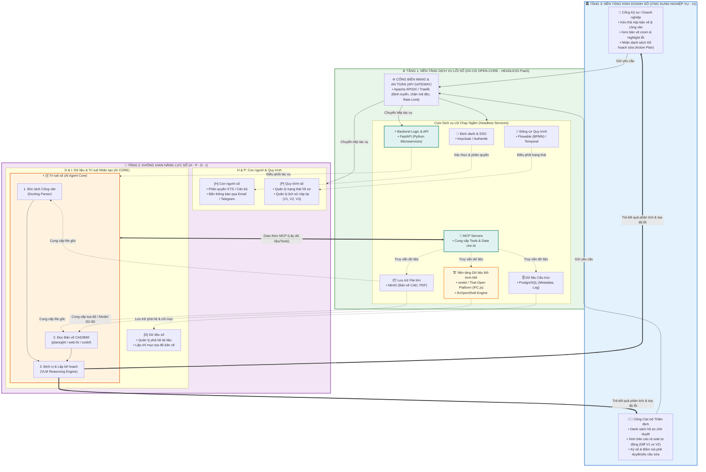
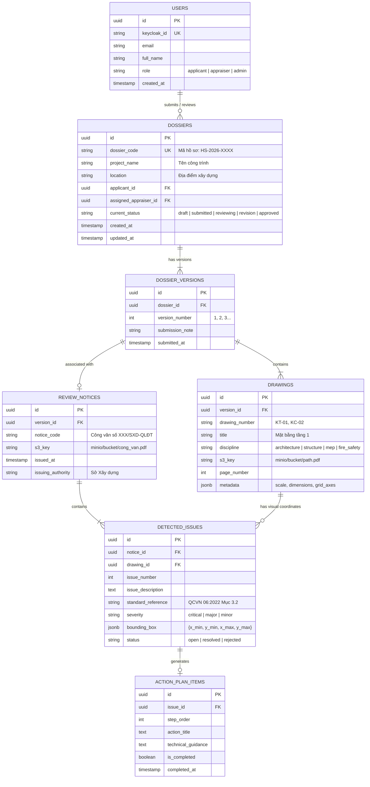

# SOFTWARE REQUIREMENTS SPECIFICATION (SRS)
## DỰ ÁN: NỀN TẢNG DX-OS OPEN-CORE & ỨNG DỤNG MÔI TRƯỜNG DỮ LIỆU CHUNG (CDE) THẨM ĐỊNH TỰ ĐỘNG HỒ SƠ XÂY DỰNG BẰNG AI AGENT

---

| Thông tin tài liệu | Chi tiết |
| :--- | :--- |
| **Tên tài liệu** | Software Requirements Specification (Đặc tả Yêu cầu Phần mềm) |
| **Dự án** | DX-OS Open-Core CDE & AI Appraisal Platform |
| **Hạng mục** | Olympic Tin học Sinh viên Việt Nam 2026 — Khối Phần mềm Nguồn Mở (PMNM) |
| **Tiêu chuẩn tài liệu** | IEEE Std 830-1998 / ISO/IEC/IEEE 29148:2018 |
| **Phiên bản** | 1.0.0 |
| **Ngày lập** | 19/10/2026 |

---

## 1. GIỚI THIỆU & KIẾN TRÚC TỔNG THỂ

### 1.1. Mục đích Tài liệu
Tài liệu Đặc tả Yêu cầu Phần mềm (SRS) này xác định các yêu cầu chức năng, phi chức năng, kiến trúc kỹ thuật, lược đồ dữ liệu và giao thức tích hợp cho hệ thống **DX-OS Open-Core** và ứng dụng **Môi trường Dữ liệu Chung (CDE) Thẩm định Hồ sơ Xây dựng số**. Tài liệu đóng vai trò là căn cứ kỹ thuật để triển khai mã nguồn, cấu hình hạ tầng và đánh giá nghiệm thu theo barem chấm thi của OLP 2026.

### 1.2. Kiến trúc Hệ thống 3 Tầng (DX-OS Open-Core Architecture)
Hệ thống được thiết kế theo đúng Khung kiến trúc 3 Tầng của Đề thi OLP 2026 kết hợp giao thức **MCP (Model Context Protocol)** và nền tảng **OpenBIM**:



---

## 2. ĐẶC TẢ YÊU CẦU CHỨC NĂNG (FUNCTIONAL REQUIREMENTS)

### 2.1. Tầng 1: Hạ tầng Nền tảng Dịch vụ Lõi số (DX-OS Open-Core Headless PaaS)

| Mã yêu cầu | Tên chức năng | Đặc tả chi tiết | Công nghệ thực thi |
| :--- | :--- | :--- | :--- |
| **FR-L1-01** | **Cổng API Gateway & Biên mạng** | • Đóng vai trò Reverse Proxy & Single Entry Point.<br>• Kiểm tra JWT Token phân quyền từ Keycloak.<br>• Thực thi Rate-Limiting (100 req/min/IP), SSL/TLS Termination.<br>• Định tuyến request đến đúng Microservice. | `Apache APISIX` / `Traefik` |
| **FR-L1-02** | **Quản trị Định danh & SSO (IAM)** | • Cung cấp đăng nhập tập trung chuẩn OpenID Connect (OIDC) / OAuth2.<br>• Quản lý 3 nhóm quyền (RBAC): `applicant` (Kỹ sư), `appraiser` (Cán bộ Sở), `admin` (Quản trị).<br>• Hỗ trợ đăng nhập đa yếu tố (MFA). | `Keycloak` / `Authentik` |
| **FR-L1-03** | **Quản trị Dữ liệu Cấu trúc** | • Quản lý cơ sở dữ liệu quan hệ cho toàn bộ metadata hồ sơ, dự án, tài khoản, phiên bản và nhật ký kiểm toán.<br>• Hỗ trợ module PostGIS để xử lý tọa độ không gian ranh giới đất/quy hoạch khi cần. | `PostgreSQL 16` |
| **FR-L1-04** | **Quản trị Dữ liệu Đối tượng (S3)** | • Lưu trữ các tệp nhị phân kích thước lớn (PDF bản vẽ, DXF, DWG, IFC 3D, file scan công văn).<br>• Tự động tạo URL truy cập có thời hạn (Pre-signed URL) để bảo mật tệp tin.<br>• Quản lý versioning cho từng tệp tải lên. | `MinIO Object Storage` |
| **FR-L1-05** | **Động cơ Quy trình (Workflow)** | • Điều khiển vòng đời của hồ sơ theo chuẩn quy trình nghiệp vụ BPMN 2.0.<br>• Cung cấp Human Task để cán bộ thẩm định nhận việc và bấm duyệt.<br>• Xử lý Timer/SLA (đếm ngược thời hạn thụ lý hồ sơ). | `Flowable BPMN Engine` / `Temporal` |
| **FR-L1-06** | **Máy chủ Giao thức MCP (MCP Server)** | • Triển khai chuẩn giao thức Model Context Protocol (Anthropic standard).<br>• Cung cấp các công cụ chuẩn hóa (Tools/Resources) cho AI Agent: `get_drawing_metadata`, `query_building_code`, `read_vector_layer`. | `FastAPI MCP Server` |
| **FR-L1-07** | **Lõi Chuyển đổi Mô hình Mở (OpenBIM Engine)** | • Phân tích và chuyển đổi hình học từ định dạng IFC và DXF sang dạng hiển thị nhẹ (glTF / SVG vector).<br>• Bóc tách thông tin thuộc tính các đối tượng xây dựng (tường, cửa, cột, thang). | `IfcOpenShell` + `ezdxf` + `web-ifc` |

---

### 2.2. Tầng 2: Không gian Năng lực Số (H - P - D - I)

#### [H] Không gian Con người số (Human Space)
* **FR-L2-01 (Đồng bộ Phiên & Phân quyền):** Ánh xạ vai trò người dùng từ Keycloak thành quyền truy cập theo từng dự án (Project-based Access Control).
* **FR-L2-02 (Thông báo Đa kênh):** Tự động phát thông báo thời gian thực (WebSocket) trên giao diện Web khi trạng thái hồ sơ thay đổi; tự động gửi thông báo qua Email/Telegram Bot cho Cán bộ và Kỹ sư.

#### [P] Không gian Quy trình số (Process Space)
* **FR-L2-03 (Quản trị Vòng đời Hồ sơ):** Quản lý chuỗi trạng thái:
  $$\text{DRAFT} \rightarrow \text{SUBMITTED} \rightarrow \text{AI\_ANALYZING} \rightarrow \text{UNDER\_REVIEW} \rightarrow \text{REVISION\_REQUIRED} \rightarrow \text{APPROVED / REJECTED}$$
* **FR-L2-04 (Quản lý Phả hệ Phiên bản):** Đánh số phiên bản tự động ($V_1, V_2, \dots, V_n$). Lưu vết lịch sử thay đổi của từng bản vẽ và công văn theo thời gian.

#### [D] Không gian Dữ liệu số (Data Space)
* **FR-L2-05 (Lập chỉ mục Bản vẽ Kỹ thuật):** Bóc tách và lập chỉ mục không gian: Khung tên bản vẽ (Title Block), số hiệu bản vẽ (KT-01, KC-02), tỷ lệ bản vẽ, danh sách lưới trục tọa độ ($A, B, C...; 1, 2, 3...$).
* **FR-L2-06 (Cơ sở Dữ liệu Quy chuẩn Kỹ thuật RAG):** Lập chỉ mục véc-tơ các quy chuẩn xây dựng trọng yếu: QCVN 06:2022/BXD (PCCC), QCVN 01:2021/BXD (Quy hoạch), Tiêu chuẩn Thiết kế Nhà ở.

#### [I] Không gian Trí tuệ số (Intelligence Space - AI AGENT CORE)
* **FR-L2-07 (Bóc tách Công văn bằng Docling Parser):**
  * Nhận diện văn bản hành chính từ file PDF hoặc ảnh chụp công văn.
  * Trích xuất chính xác các điều khoản yêu cầu sửa đổi thành danh sách đối tượng JSON có cấu trúc gồm: `issue_index`, `content`, `standard_ref`, `discipline`.
* **FR-L2-08 (Định vị Lỗi lên Bản vẽ - Multimodal Grounding):**
  * Mô hình suy luận thị giác kết hợp Vector Search để xác định vị trí bản vẽ liên quan đến từng yêu cầu sửa đổi.
  * Tính toán tọa độ hộp bao (Bounding Box: $[x_{\min}, y_{\min}, x_{\max}, y_{\max}]$ theo tỷ lệ phần trăm) tương ứng trên trang bản vẽ.
* **FR-L2-09 (Sinh Kế hoạch Sửa đổi - Action Plan Generator):**
  * Sinh tự động bảng kế hoạch khắc phục gồm: Tên đầu việc, bản vẽ cần sửa, giải pháp kỹ thuật đề xuất, điều khoản quy chuẩn đối chiếu.
  * Hỗ trợ xuất file Báo cáo Giải trình mẫu (`.docx` / `.pdf`).
* **FR-L2-10 (Động cơ So sánh Sai lệch Tự động - Visual/Vector Diffing):**
  * So khớp giữa phiên bản $V_{k-1}$ và phiên bản mới $V_k$.
  * Phân loại:
    1. Vùng đã sửa đổi theo đúng yêu cầu công văn (Màu xanh).
    2. Vùng chưa được sửa đổi (Màu đỏ).
    3. Vùng bị thay đổi ngoài phạm vi yêu cầu (Màu vàng - Cảnh báo sửa lén).

---

### 2.3. Tầng 3: Nền tảng Ứng dụng Nghiệp vụ (Web Portal)

#### Cổng Kỹ sư / Doanh nghiệp (Applicant Portal)
* **FR-L3-01 (Nộp Hồ sơ & Công văn):** Kéo thả file PDF bản vẽ và file PDF/Ảnh chụp công văn. Xem tiến trình tải lên và trạng thái AI đang phân tích.
* **FR-L3-02 (Trình xem Bản vẽ Tương tác - Interactive Viewer):** Hiển thị bản vẽ độ phân giải cao; tự động vẽ các bounding box màu đỏ lên các vị trí vi phạm. Cho phép phóng to, thu nhỏ, xoay và đo kích thước.
* **FR-L3-03 (Bảng điều khiển Action Plan):** Bảng checklist các việc cần sửa. Khi click vào một mục lỗi, màn hình bản vẽ bên cạnh tự động cuộn (auto-scroll) và zoom mượt mà vào đúng vị trí lỗi đó.

#### Cổng Cán bộ Thẩm định (Appraiser Portal)
* **FR-L3-04 (Hàng đợi Hồ sơ Thẩm định):** Hiển thị danh sách hồ sơ được phân công, có bộ lọc theo mức độ khẩn, thời hạn SLA còn lại.
* **FR-L3-05 (Giao diện So sánh Trực quan Diff Viewer):** Màn hình chia đôi (Split Screen) hoặc Chế độ phủ lớp (Overlay Slider) so sánh trực tiếp bản vẽ cũ và bản vẽ mới.
* **FR-L3-06 (Phê duyệt & Ký số):** Xác nhận các hạng mục đã được khắc phục đạt chuẩn, nhập ý kiến phản hồi hoặc bấm nút [Phê duyệt Cấp phép] / [Ban hành Yêu cầu Bổ sung Lần 2].

---

## 3. ĐẶC TẢ YÊU CẦU PHI CHỨC NĂNG (NON-FUNCTIONAL REQUIREMENTS)

### 3.1. Hiệu năng & Khả năng Xử lý (Performance)
* **NFR-01 (Thời gian tải bản vẽ):** Hiển thị trang bản vẽ khổ lớn (A1, A0 độ phân giải cao) trên Web Viewer trong thời gian **$< 2.5$ giây**.
* **NFR-02 (Thời gian xử lý AI):** Bóc tách 01 công văn (dưới 5 trang) và định vị lỗi trên bộ hồ sơ (dưới 20 trang bản vẽ) hoàn thành trong thời gian **$< 45$ giây**.
* **NFR-03 (Khả năng đáp ứng API):** Thời gian phản hồi của các API thông thường (không tính tác vụ AI) đạt **$< 200$ ms** ở mức 95th percentile.

### 3.2. An toàn & Bảo mật Thông tin (Security & Zero-Trust)
* **NFR-04 (Xác thực không tín nhiệm):** Mọi request đi vào hệ sinh thái đều bắt buộc phải mang JWT Token hợp lệ do Keycloak cấp phát, được xác thực chữ ký số tại API Gateway.
* **NFR-05 (Bảo vệ Dữ liệu Hồ sơ):** File bản vẽ trong MinIO không được mở public; mọi liên kết tải/xem file đều phải thông qua Pre-signed URL có thời hạn tối đa 15 phút.
* **NFR-06 (Toàn vẹn Dữ liệu):** Không cho phép thao tác `HARD DELETE` đối với các hồ sơ và bản vẽ đã nộp; mọi thay đổi trạng thái đều được ghi nhật ký kiểm toán (Audit Trail) bất biến.

### 3.3. Tuân thủ Tiêu chuẩn Phần mềm Nguồn Mở (Open-Source Compliance)
* **NFR-07 (Tự do Nguồn mở 100%):** Toàn bộ các công nghệ, thư viện, mô hình sử dụng đều tuân thủ các giấy phép nguồn mở được công nhận (MIT, Apache 2.0, MPL 2.0, BSD, AGPL). Tuyệt đối không sử dụng các dịch vụ SaaS đám mây đóng có thu phí (như Autodesk Forge / OpenAI API).
* **NFR-08 (Độc lập Hạ tầng & Tự chủ Số):** Toàn bộ hệ thống có khả năng tự triển khai chạy offline trên máy chủ cục bộ hoặc server on-premise mà không phụ thuộc vào kết nối Internet ra bên ngoài.

---

## 4. THIẾT KẾ MÔ HÌNH DỮ LIỆU (DATABASE SCHEMA)

Hệ thống sử dụng cơ sở dữ liệu **PostgreSQL 16**. Lược đồ dữ liệu cốt lõi bao gồm các thực thể chính sau:



---

## 5. THIẾT KẾ GIAO THỨC TÍCH HỢP & MCP (MODEL CONTEXT PROTOCOL)

### 5.1. Kiến trúc Tích hợp MCP Server
Để tách biệt hoàn toàn giữa mô hình Trí tuệ Nhân tạo và Dữ liệu hạ tầng, hệ thống triển khai một **FastAPI MCP Server** cung cấp các Tools và Resources chuẩn hóa:

```
[AI AGENT (VLM / LLM Core)]
       │
       │ Giao thức Chuẩn Model Context Protocol (JSON-RPC)
       ▼
[FASTAPI MCP SERVER]
       ├─ Tool: parse_notice_document(notice_s3_key) ──▶ Gọi Docling Parser
       ├─ Tool: get_drawing_vector_layer(drawing_id)  ──▶ Gọi ezdxf / web-ifc
       ├─ Tool: query_standard_rag(query_text)        ──▶ Truy vấn PostgreSQL / pgvector
       └─ Resource: dossier://{dossier_id}/version/{v} ──▶ Trả về toàn bộ metadata hồ sơ
```

### 5.2. Các Giao diện Lập trình REST API Cốt lõi
* `POST /api/v1/dossiers`: Tạo mới hồ sơ đề nghị thẩm định.
* `POST /api/v1/dossiers/{id}/versions`: Tải lên bộ bản vẽ phiên bản mới.
* `POST /api/v1/dossiers/{id}/versions/{v}/notice`: Tải lên công văn yêu cầu sửa đổi.
* `POST /api/v1/ai/analyze/{notice_id}`: Kích hoạt Tác tử AI bóc tách công văn và định vị lỗi lên bản vẽ.
* `GET /api/v1/ai/action-plan/{notice_id}`: Lấy danh sách Kế hoạch sửa đổi kèm tọa độ trực quan.
* `POST /api/v1/ai/diff-check`: Kích hoạt so sánh sai lệch giữa phiên bản $V_1$ và $V_2$.

---

## 6. ĐẶC TẢ TRIỂN KHAI & HẠ TẦNG THỰC NGHIỆM (DOCKER COMPOSE)

Toàn bộ hệ thống Tầng 1 và Backend Tầng 2 được đóng gói trong một cấu hình Docker Compose chuẩn mực, cho phép triển khai đồng bộ bằng một câu lệnh:

| Container Service | Image Mã nguồn Mở | Port Nội bộ | Nhiệm vụ Kiến trúc |
| :--- | :--- | :--- | :--- |
| `gateway` | `apache/apisix:3.9-debian` | 9080 (HTTP), 9443 (HTTPS) | API Gateway & Reverse Proxy |
| `identity` | `quay.io/keycloak/keycloak:24.0` | 8080 | Quản lý Đăng nhập SSO & Phân quyền |
| `postgres` | `postgres:16-alpine` | 5432 | Database quan hệ lưu trữ Metadata & Logs |
| `storage` | `minio/minio:latest` | 9000 (API), 9001 (Console) | S3 Object Storage lưu trữ bản vẽ |
| `workflow` | `flowable/flowable-rest:latest` | 8090 | Động cơ quản lý luồng quy trình BPMN |
| `backend-api` | Tự xây dựng (FastAPI Python 3.11) | 8000 | Backend REST API & MCP Server |
| `ai-engine` | Tự xây dựng (PyTorch + Docling + VLM) | 8001 | Xử lý đa phương thức OCR & Định vị bản vẽ |
| `frontend` | Tự xây dựng (React / Nuxt + Web Viewer) | 3000 | Giao diện người dùng Web Portal |

---

## 7. KẾT LUẬN & ĐỐI CHIẾU TIÊU CHÍ OLP 2026

Bản đặc tả yêu cầu phần mềm này đảm bảo:
1. **Khớp 100% Khung Đề thi OLP 2026:** Đủ 3 Tầng kiến trúc, Tầng 1 là Headless PaaS, Tầng 2 theo khung H-P-D-I, Tầng 3 là ứng dụng CDE Xây dựng thực chiến.
2. **Khắc phục hoàn toàn rủi ro bản quyền:** Thay thế toàn bộ giải pháp đóng (như Autodesk Forge) bằng giải pháp OpenBIM chuẩn quốc tế (`web-ifc`, `ezdxf`, `IfcOpenShell`).
3. **Tiên phong Công nghệ:** Đưa vào giao thức **MCP (Model Context Protocol)** và động cơ bóc tách hiện đại **Docling**, tạo lợi thế công nghệ vượt trội để tranh chấp giải cao.
