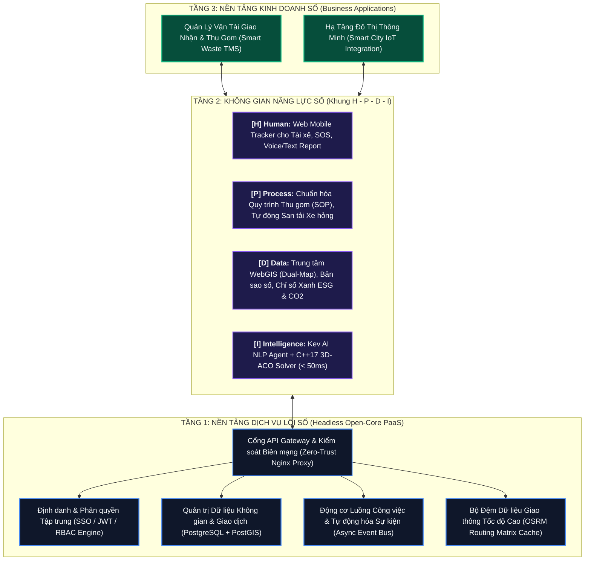

# 🏛️ Kiến Trúc Hệ Điều Hành Chuyển Đổi Số: DX-OS Open-Core
### (Open-Source Digital Transformation Operating System - OLP 2026)

Tài liệu đặc tả kiến trúc kỹ thuật của hệ thống dự thi **Olympic Tin học Sinh viên Việt Nam 2026 (Khối Phần mềm Nguồn mở - VFOSSA)**. Hệ thống được xây dựng bám sát 100% Khung Kiến trúc 3 Tầng theo đề bài của Ban Tổ Chức.

---

## 🏗️ 1. Sơ Đồ Kiến Trúc Tháp 3 Tầng (3-Tier DX-OS Architecture)

---

## 🧩 2. Chi Tiết Các Tầng Kỹ Thuật

### Tầng 1: Nền tảng Dịch vụ Lõi số (Headless Open-Core PaaS)
Hoạt động hoàn toàn ngầm không giao diện (Headless PaaS), cung cấp các dịch vụ dùng chung nền móng:
1. **API Gateway & Biên mạng:** Kiểm soát truy cập tập trung, phân luồng lưu lượng tới các microservices.
2. **Định danh & Bảo mật (Identity/SSO):** Cung cấp cơ chế xác thực JWT, bảo vệ thông tin cá nhân và phân quyền theo vai trò (Admin, Điều phối viên, Tài xế, Giám sát).
3. **Cơ sở dữ liệu Không gian (Spatial OLTP):** PostgreSQL tích hợp phần mở rộng **PostGIS** lưu trữ dữ liệu địa lý (tọa độ trạm trung chuyển, vị trí bô rác, vết di chuyển GPS của đội xe).
4. **Động cơ luồng công việc & Sự kiện (Workflow & Event Bus):** Đón nhận các sự kiện thời gian thực (rào chắn, xe hỏng, thùng rác đầy) và tự động kích hoạt tiến trình xử lý ngầm.
5. **Bộ đệm đồ thị OSRM:** Lưu trữ ma trận khoảng cách thực tế giữa các nút giao thông, phục vụ tính toán định tuyến tức thời.

---

### Tầng 2: Không gian Năng lực Quản trị số H-P-D-I
Lớp đệm chuyển giao năng lực quản trị theo mô hình trưởng thành số:
* **[H] Human (Con người số):** Ứng dụng di động tác nghiệp hiện trường không cần cài đặt (Web Mobile Tracker), hỗ trợ tài xế nhận lộ trình, gửi báo cáo sự cố bằng giọng nói/chữ viết và nút SOS khẩn cấp.
* **[P] Process (Quy trình số):** Số hóa quy trình thu gom thường kỳ và quy trình xử lý ngoại lệ tự động (tránh đường cấm, phân bổ lại thùng rác của xe bị hỏng).
* **[D] Data (Dữ liệu số):** Trung tâm điều hành thông minh (IOC) với chế độ **Bản đồ Kép (Dual-Map)**, hiển thị bản sao số (Digital Twin) của toàn bộ mạng lưới thu gom và bảng đồng hồ đo lường phát thải $\text{CO}_2$, năng lượng và chi phí vận hành (ESG).
* **[I] Intelligence (Trí tuệ số):** Tích hợp Tác tử thông minh **Kev AI** phân loại ngữ nghĩa báo cáo hiện trường và Động cơ giải thuật tối ưu bầy đàn **3D-ACO** phát triển bằng C++17 cho tốc độ giải bài toán định tuyến trong `< 50ms`.

---

### Tầng 3: Ứng dụng Thực chứng Quản trị Đô thị Thông minh (Smart City Waste TMS)
* Ứng dụng chuyên ngành Quản lý vận tải giao nhận (TMS) và Hạ tầng đô thị thông minh (Smart City IoT), giải quyết bài toán môi trường và giao thông nhức nhối tại các đại đô thị Việt Nam.
