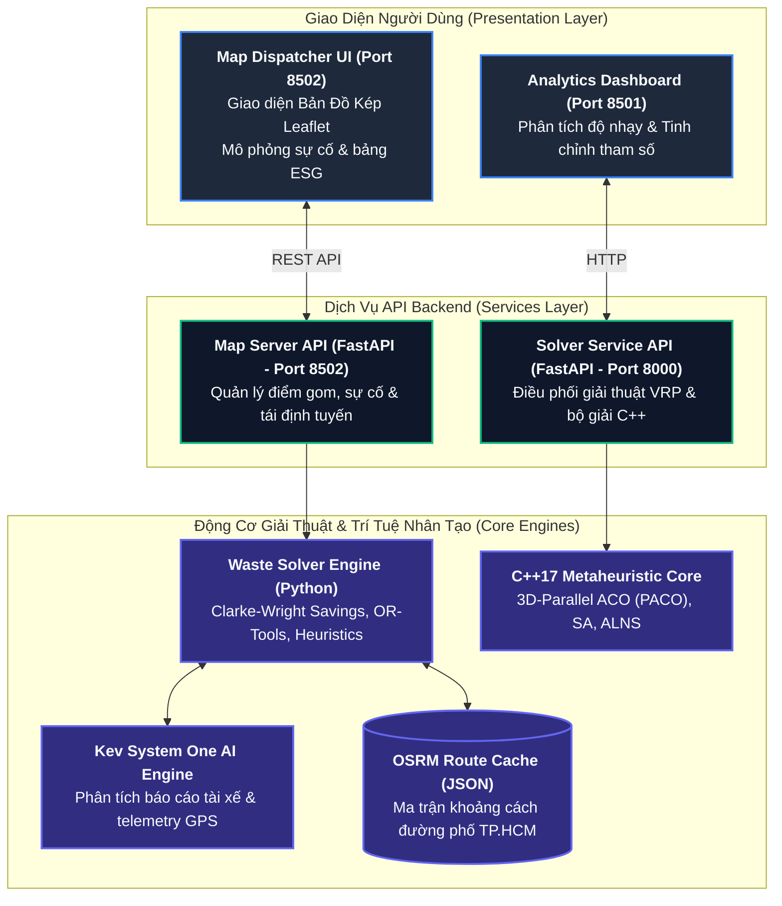

# Đặc Tả Kiến Trúc Kỹ Thuật Hệ Thống

Hệ thống được thiết kế theo kiến trúc dịch vụ phân tán gồm 3 phân hệ chính kết nối qua giao thức HTTP RESTful và chia sẻ ma trận định tuyến OSRM:

---

## 1. Sơ Đồ Kiến Trúc Hệ Thống

---

## 2. Phân Hệ Chi Tiết

### 1. Phân Hệ Điều Phối Bản Đồ Thời Gian Thực (`map_ui/` - Port 8502)
* **`server.py`:** Máy chủ FastAPI quản lý các kịch bản mẫu đô thị tại TP.HCM (Quận 1, Quận 3), tiếp nhận sự cố hiện trường và điều phối tái định tuyến.
* **`index.html`:** Giao diện điều phối tương tác thời gian thực hỗ trợ chế độ Bản Đồ Kép (Dual-Map), trực quan hóa vết xe chạy, cảnh báo rào chắn công trình, đo lường chỉ số phát thải $\text{CO}_2$, và hộp thoại điều phối thông minh **Kev AI**.
* **`waste_solver.py`:** Bộ giải tích hợp nhiều thuật toán:
  - **Tích hợp Tác tử Kev AI (Kev System One):** Tiếp nhận báo cáo ngôn ngữ tự nhiên từ tài xế và vị trí GPS để phân loại mức độ sự cố và kích hoạt tái định tuyến tự động.
  - **Clarke-Wright Savings:** Tối ưu hóa tải trọng phương tiện có xét trọng số ưu tiên điểm bốc mùi (`has_smell`).
  - **Google OR-Tools VRP:** Mô hình tham chiếu so sánh đối chứng.
  - **Tái định tuyến sự cố (< 50ms):** Tự động phát hiện đoạn đường bị rào chắn và tìm đường vòng tránh điểm nghẽn.
  - **Phân bổ thu gom ngõ hẻm (Walk-in Alley):** Tự động tính toán điểm đỗ xe đầu hẻm cho các bô rác không thể tiếp cận bằng xe cơ giới.
* **`route_cache.json`:** Bộ đệm ma trận tọa độ đường phố TP.HCM giúp truy xuất lộ trình siêu tốc không phụ thuộc vào đường truyền mạng ngoài.

---

### 2. Phân Hệ API Backend & Điều Phối Lõi (`backend/` - Port 8000)
* **`main.py`:** Cổng API giải bài toán VRP định dạng chuẩn Solomon / Li & Lim.
* **`service.py`:** Trình bao bọc (wrapper) gọi thực thi các tệp nhị phân C++ đã biên dịch.
* **`waste_dispatcher.py`:** Quản lý hàng đợi sự cố, tiếp nhận báo cáo phân loại từ tài xế và tích hợp giao tiếp với Kev System One AI Engine.

---

### 3. Phân Hệ Nghiên Cứu & Tinh Chỉnh Tham Số (`streamlit/` - Port 8501)
* **`app.py`:** Bảng điều khiển phân tích độ nhạy thuật toán (Sensitivity Analysis), khảo sát tác động của các siêu tham số $\alpha, \beta, \rho$ đối với chất lượng nghiệm.
* **`solver_api_client.py`:** Thư viện client gọi sang backend port 8000.

---

### 4. Lõi Thuật Toán C++17 (`src/`)
* **Kiến trúc song song:** Tận dụng OpenMP xử lý đa luồng trên CPU máy chủ.
* **Các thuật toán cài đặt:**
  - `PACO.cpp`: Parallel Ant Colony Optimization.
  - `SA.cpp`: Simulated Annealing.
  - `GA.cpp`: Genetic Algorithm.
  - `ALNS.cpp`: Adaptive Large Neighborhood Search.
* **Dữ liệu thực nghiệm:** Thư viện Solomon benchmarks 25, 50, 100 khách hàng (`src/data/`).
