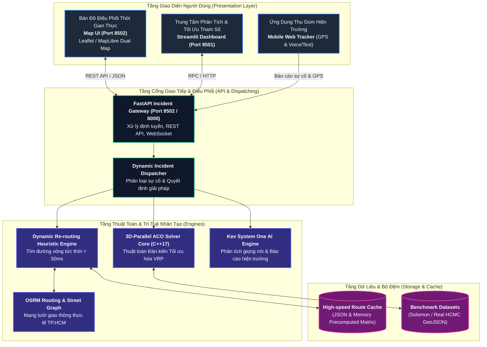
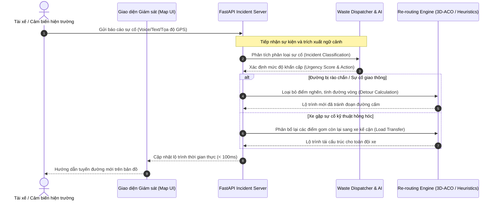

# Kiến Trúc Hệ Thống: Smart Waste Management & Dynamic Incident Re-routing Platform

Hệ thống được thiết kế theo mô hình vi dịch vụ phân tán (Microservices & Event-Driven Architecture), phục vụ bài toán tối ưu hóa vận tải đô thị xanh, tự động điều phối đội xe gom rác thời gian thực và xử lý sự cố tức thì (*Dynamic Incident Re-routing*).

---

## 🏗️ 1. Sơ Đồ Kiến Trúc Tổng Thể (System Architecture)

---

## ⚙️ 2. Luồng Xử Lý Sự Cố Động (Dynamic Incident Resolution Flow)

Khi phát sinh sự cố trong quá trình xe gom rác di chuyển trên đường phố (ngập úng, rào chắn công trình hẻm nhỏ, xe hư hỏng kỹ thuật hoặc rác thải nguy hại), quy trình điều phối diễn ra như sau:

---

## 🗺️ 3. Quy Chuẩn Bản Đồ & Chủ Quyền Lãnh Thổ (Map Sovereignty)

Dự án tuân thủ nghiêm ngặt quy định về chủ quyền lãnh thổ Việt Nam và tiêu chuẩn trình bày bản đồ trong các kỳ thi CNTT cấp quốc gia:
- **100% Tuyệt đối không sử dụng các nguồn bản đồ có đường lưỡi bò (đường 9 đoạn)**.
- Tích hợp lớp bản đồ chuẩn quốc tế:
  - **OpenStreetMap** chính thức qua tile server chuẩn.
  - **ArcGIS World Imagery** vệ tinh độ nét cao.
  - Tùy chọn Google Maps chuẩn với tham số quốc gia Việt Nam (`hl=vi`).
- Dữ liệu điểm tập kết, bô rác và lộ trình lấy mẫu thực nghiệm trực tiếp tại các phường thuộc **Quận 1, Quận 3, TP. Hồ Chí Minh**.

---

## 🌿 4. Mô Hình Đo Lường Môi Trường (ESG & Carbon Emission Model)

Hệ thống tính toán trực tiếp chỉ số xanh và hiệu quả môi trường sau mỗi lần tối ưu:
- **Quãng đường cắt giảm:** $\Delta D = D_{\text{truyền thống}} - D_{\text{tối ưu}}$ (km).
- **Phát thải $\text{CO}_2$ tiết kiệm:** $E = \Delta D \times 0.285 \text{ kg CO}_2/\text{km}$ (hệ số tiêu chuẩn xe tải thu gom đô thị hạng nhẹ).
- **Chi phí nhiên liệu tiết kiệm:** $C = \Delta D \times \text{Định mức tiêu hao} \times \text{Đơn giá nhiên liệu}$.
