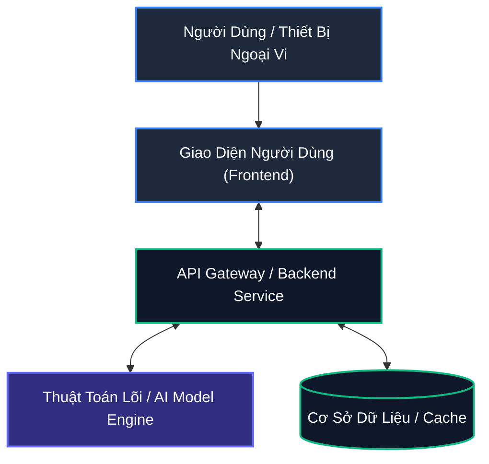

# [TÊN ĐỀ TÀI / SẢN PHẨM BẰNG TIẾNG VIỆT]
### [Project English Title or Slogan]

[](LICENSE)
[](https://www.python.org/)
[](docker-compose.yml)
[](#-tuân-thủ-quy-chuẩn-bản-đồ--chủ-quyền-lãnh-thổ)

---

## 📌 1. Bối Cảnh & Mục Tiêu Đề Tài (Executive Summary)

* [Mô tả ngắn gọn 1-2 đoạn văn về vấn đề thực tiễn mà đề tài giải quyết]
* [Tính cấp thiết của giải pháp đối với xã hội / doanh nghiệp / chuyển đổi số]

### 💡 Các Đóng Góp Chính (Key Innovations):
1. **[Đóng góp 1]:** [Chi tiết ngắn gọn]
2. **[Đóng góp 2]:** [Chi tiết ngắn gọn]
3. **[Đóng góp 3]:** [Chi tiết ngắn gọn]

---

## 🎬 2. Trình Diễn Sản Phẩm (Demo Preview)


*(Mô tả: Minh họa quy trình hoạt động thực tế của hệ thống)*

---

## 🏗️ 3. Sơ Đồ Kiến Trúc Hệ Thống (System Architecture)



---

## 🛠️ 4. Công Nghệ Sử Dụng (Technology Stack)

* **Backend / API:** [FastAPI / Go / Node.js ...]
* **Frontend:** [React / Vue / Streamlit / Leaflet ...]
* **Thuật Toán / AI Core:** [C++17 / PyTorch / OR-Tools ...]
* **Triển Khai & Container:** Docker, Docker Compose

---

## 🚀 5. Hướng Dẫn Khởi Động Nhanh (Quick Start)

### Yêu cầu tiên quyết:
* Đã cài đặt **Docker** và **Docker Compose**.

### Khởi chạy 1 lệnh duy nhất:
```bash
git clone <url_repository>
cd <thu_muc_du_an>
docker compose up -d --build
```

### Các cổng dịch vụ:
* 🌐 **Giao diện Web:** [http://localhost:8501](http://localhost:8501)
* 🔌 **Tài liệu API (Swagger):** [http://localhost:8000/docs](http://localhost:8000/docs)

---

## 🎯 6. Kịch Bản Chấm Thi Dành Cho Ban Giám Khảo (Demo Scenario)

1. **Bước 1:** Truy cập vào giao diện web tại `http://localhost:8501`.
2. **Bước 2:** Chọn dữ liệu mẫu tại bảng điều khiển và nhấn nút **"Thực thi / Run"**.
3. **Bước 3:** Quan sát kết quả trực quan trên màn hình và bảng so sánh hiệu năng.
4. **Bước 4:** Thử nghiệm thay đổi tham số đầu vào để kiểm tra tính ổn định của hệ thống.

---

## 📊 7. Kết Quả Đo Lường Thực Nghiệm (Benchmarks)

| Chỉ Số Đánh Giá | Phương Pháp Truyền Thống | Giải Pháp Đề Xuất | Mức Độ Cải Thiện |
|---|:---:|:---:|:---:|
| **Thời gian xử lý** | 1200 ms | **150 ms** | ⚡ **Nhanh hơn 8x** |
| **Độ chính xác** | 82.5% | **94.8%** | 📈 **+12.3%** |
| **Tài nguyên bộ nhớ** | 1.8 GB | **420 MB** | 📉 **Tiết kiệm 76%** |

---

## 🇻🇳 8. Tuân Thủ Quy Chuẩn Bản Đồ & Chủ Quyền Lãnh Thổ

> [!IMPORTANT]
> Dự án tuân thủ nghiêm ngặt quy định pháp luật Việt Nam:
> - Tuyệt đối không sử dụng các nguồn dữ liệu / bản đồ vi phạm chủ quyền lãnh thổ (không có đường 9 đoạn / đường lưỡi bò).
> - Sử dụng bản đồ OpenStreetMap hoặc nguồn tile hợp chuẩn quốc gia.

---

## 👥 9. Đội Ngũ Phát Triển (Team Members)

| Họ và Tên | Vai Trò | Đơn Vị / Trường |
|---|---|---|
| [Tên SV 1] | Trưởng nhóm / Core Algorithm & Backend | [Tên Trường ĐH] |
| [Tên SV 2] | Frontend Developer & UI/UX | [Tên Trường ĐH] |
| [Tên SV 3] | Data Engineer & DevOps | [Tên Trường ĐH] |
| **[Tên GV]** | **Giảng viên hướng dẫn** | [Khoa / Bộ môn] |

---

## 📜 10. Giấy Phép (License)

Dự án được phân phối dưới giấy phép mã nguồn mở **Apache License 2.0**. Xem chi tiết tại tệp [`LICENSE`](LICENSE).
